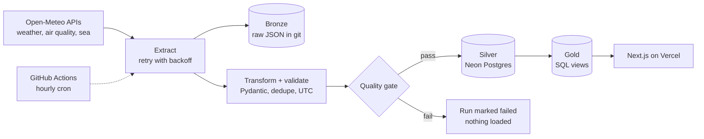

# Cebu Pulse

[](https://github.com/epsilonv098-glitch/Weatherlang/actions/workflows/ci.yml)
[](https://github.com/epsilonv098-glitch/Weatherlang/actions/workflows/ingest.yml)


**An hourly, free-tier data pipeline that turns weather, air quality and sea forecasts for 12 places in Cebu into a live dashboard.**

**Live demo:** _add your Vercel URL here_

| Map | Place page | Beaches | Pipeline |
|---|---|---|---|
| _screenshot_ | _screenshot_ | _screenshot_ | _screenshot_ |

## Architecture



## Tech stack

- **Pipeline:** Python 3.12, requests, Pydantic v2, psycopg 3, pytest
- **Storage:** Neon Postgres (plain `.sql` files, no ORM or dbt)
- **Orchestration and CI:** GitHub Actions (hourly ingest, tests on every push)
- **Web:** Next.js (App Router), TypeScript, Tailwind, Recharts, Framer Motion, Leaflet, `@neondatabase/serverless`, hosted on Vercel
- **Cost:** everything runs on free tiers

## Data sources and limits

Weather, air quality and sea data come from [Open-Meteo](https://open-meteo.com). Air quality is based on the CAMS ENSEMBLE data provider. Map tiles are from OpenStreetMap contributors.

These are **modeled estimates for a grid cell**, not sensor readings. They can differ from local sensors and consumer weather apps. The air quality grid is coarse (tens of km), the "feels like" value is not PAGASA's official heat index, and `us_aqi` is the highest of several pollutant indices, so it can be higher than PM2.5 alone suggests.

## How to run

**Pipeline**
```bash
python -m venv .venv && source .venv/bin/activate
pip install -r requirements.txt
pytest -q
export DATABASE_URL='postgresql://...'      # your Neon connection string
python -m pipeline.load init                # create tables and gold views
python -m pipeline.run                      # one full run
```

**Website**
```bash
cd web && npm install
echo "DATABASE_URL=postgresql://..." > .env.local
npm run dev
```

**Deploy:** import the repo in Vercel with root directory `web` and a `DATABASE_URL` environment variable. For hourly ingest, add `DATABASE_URL` as a GitHub Actions secret. See `.env.example`.

## Key design decisions

Full reasoning is in [docs/decisions.md](docs/decisions.md).

- **ELT with bronze, silver and gold:** raw data is kept untouched, so any cleaning bug can be fixed and replayed.
- **Idempotent upserts:** re-running the pipeline never duplicates rows.
- **A quality gate before loading:** stale or incomplete batches fail the run and load nothing.
- **UTC in the database, Asia/Manila on screen.**
- **GitHub Actions as the orchestrator:** no servers to run.

## What I learned

_Draft. Edit this to match your own experience._

- Free weather data is modeled, so numbers differ between providers. I learned to validate against the source API and to say so on the site.
- A headline index like US AQI is the maximum of several pollutants, so it can disagree with PM2.5.
- A plain `ON CONFLICT` upsert burns an identity value on every run, so I look up existing rows first.
- Storing UTC and converting at the edge avoids most time-zone bugs.
- Testing the pipeline with fixture data and a fake database found problems before the real run did.

